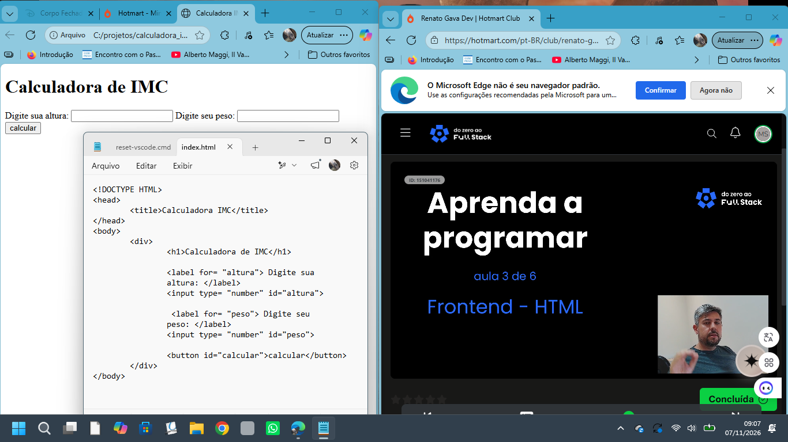
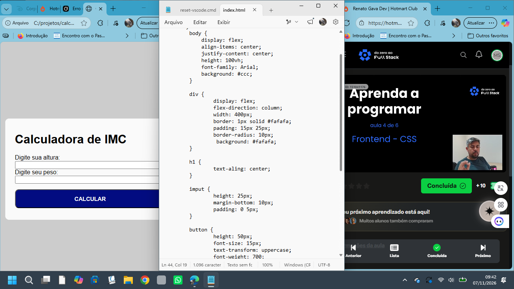
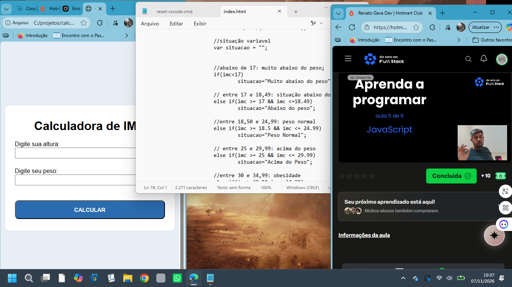

# Calculadora de IMC 

Projeto de aquecimento desenvolvido durante as aulas de **Frontend** do curso **Full Stack em 1 Dia** com o professor **Renato Gava**.

Este trabalho faz parte da minha busca por crescimento e compreensão da programação. Já estudo desenvolvimento no **SESI SENAI Concórdia** e o objetivo é evoluir até ser capaz de construir um sistema **Full Stack** completo, do início ao fim.

## Sobre o Projeto

A Calculadora de IMC permite que o usuário informe altura e peso e, ao clicar em Calcular, receba a classificação do Índice de Massa Corporal com base nos valores informados.

O projeto foi construído passo a passo, acompanhando as aulas:

- **Aula 1** — Introdução: o que é programação e quem é o programador
- **Aula 2** — O que é um algoritmo (passos a serem seguidos)
- **Aula 3** — Estrutura HTML
- **Aula 4** — Estilização com CSS
- **Aula 5** — Lógica com JavaScript
- **Aula 6** — Versionamento com Git e GitHub

## Tecnologias

- HTML5
- CSS3 (Flexbox)
- JavaScript (DOM e eventos)
- Git e GitHub

## Aulas e Evolução do Projeto

### Aula 1 — Introdução à Programação
Conceitos iniciais sobre o que é programação e o papel do programador.


### Aula 2 — Algoritmos
Entendimento de algoritmo como sequência de passos para resolver um problema.


### Aula 3 — HTML
Criação da estrutura da calculadora com HTML.



### Aula 4 — CSS
Estilização da página, centralização e formatação do formulário.



### Aula 5 — JavaScript
Implementação da lógica de cálculo do IMC e classificação do resultado.



### Resultado Final
Visual completo da calculadora após a aplicação do CSS.


### Aula 6 — Git e GitHub
Versionamento do projeto e envio para o repositório.


## Como executar

1. Clone o repositório:
   ```bash
   git clone https://github.com/sangaletti35-ops/calculadora-imc.git
